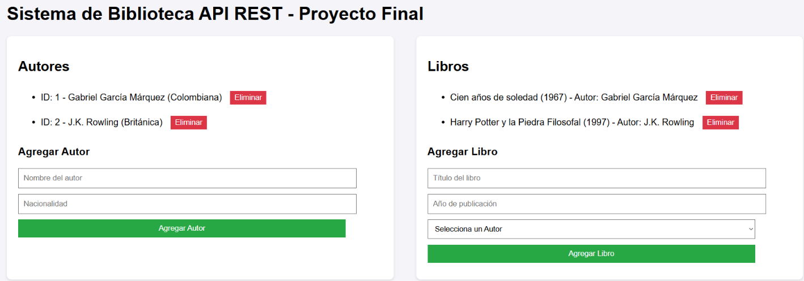
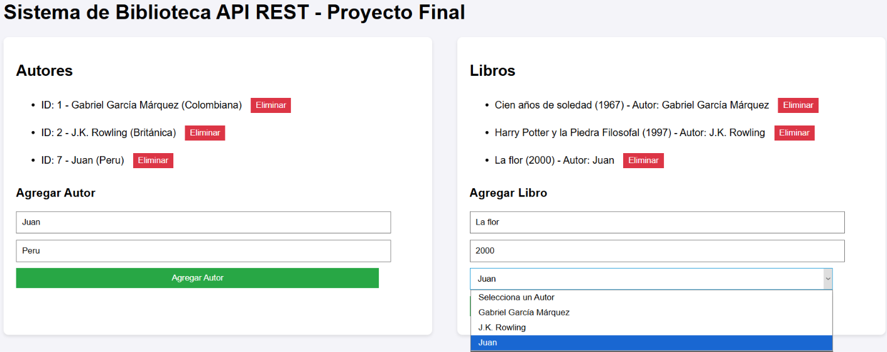

# API REST de Biblioteca

Aplicación web para administrar una biblioteca de autores y libros. Un backend en Flask expone una API REST sobre una base de datos SQLite, y una interfaz en HTML, CSS y JavaScript se comunica con ella mediante peticiones `fetch`, actualizando la página sin recargarla.

## Tecnologías

- **Lenguaje backend:** Python 3
- **Framework:** Flask
- **Base de datos:** SQLite (módulo `sqlite3` incluido en Python), con dos tablas relacionadas
- **Frontend:** HTML, CSS y JavaScript puro (`fetch`, sin librerías externas)

## Estructura

```
api-rest-biblioteca/
├── imagenes/              # Capturas de pantalla usadas en este README
│   ├── interfaz.png
│   └── agregar.png
├── static/
│   └── script.js          # Lógica del frontend (peticiones a la API)
├── templates/
│   └── index.html         # Interfaz web (incluye sus estilos)
├── app.py                 # Servidor Flask, endpoints y creación de la base de datos
├── requirements.txt       # Dependencias de Python
└── README.md
```

La base de datos `biblioteca.db` **se crea sola** la primera vez que se ejecuta `app.py`, con dos autores y dos libros de ejemplo, por lo que no se incluye en el repositorio.

## Cómo ejecutarlo

1. Instala [Python 3](https://www.python.org/downloads/) si no lo tienes.
2. Descarga o clona este repositorio y abre una terminal dentro de la carpeta.
3. Instala las dependencias:
   ```bash
   pip install -r requirements.txt
   ```
4. Inicia el servidor:
   ```bash
   python app.py
   ```
5. Abre en el navegador: [http://127.0.0.1:5000](http://127.0.0.1:5000)

Para detener el servidor, presiona `Ctrl + C` en la terminal.

## Base de datos

Dos tablas relacionadas: un autor puede tener varios libros.

| Tabla | Columnas |
|---|---|
| `autores` | `id` (PK, autoincremental), `nombre`, `nacionalidad` |
| `libros` | `id` (PK, autoincremental), `titulo`, `anio`, `autor_id` (FK → `autores.id`) |

La llave foránea tiene `ON DELETE CASCADE`: al eliminar un autor, también se eliminan sus libros. SQLite no activa las llaves foráneas por defecto, por lo que la aplicación ejecuta `PRAGMA foreign_keys = ON` en cada conexión.

## Endpoints de la API

### Autores

| Método | Ruta | Descripción | Respuestas |
|---|---|---|---|
| GET | `/autores` | Lista todos los autores | 200, 500 |
| GET | `/autores/<id>` | Obtiene un autor | 200, 404, 500 |
| POST | `/autores` | Agrega un autor | 201, 400, 500 |
| PUT | `/autores/<id>` | Actualiza un autor | 200, 400, 404, 500 |
| DELETE | `/autores/<id>` | Elimina un autor y sus libros | 200, 500 |

### Libros

| Método | Ruta | Descripción | Respuestas |
|---|---|---|---|
| GET | `/libros` | Lista los libros con el nombre de su autor | 200, 500 |
| GET | `/libros/<id>` | Obtiene un libro | 200, 404, 500 |
| POST | `/libros` | Agrega un libro | 201, 400, 500 |
| PUT | `/libros/<id>` | Actualiza título y año de un libro | 200, 400, 500 |
| DELETE | `/libros/<id>` | Elimina un libro | 200, 500 |

### Códigos de respuesta
- **200** operación correcta
- **201** recurso creado
- **400** faltan datos requeridos
- **404** recurso no encontrado
- **500** error de base de datos

### Ejemplos

**Agregar un autor** (`POST /autores`)
```json
{ "nombre": "Julio Cortázar", "nacionalidad": "Argentina" }
```
Respuesta `201`:
```json
{ "mensaje": "Autor agregado exitosamente" }
```

**Agregar un libro** (`POST /libros`)
```json
{ "titulo": "Rayuela", "anio": 1963, "autor_id": 3 }
```

**Consultar libros** (`GET /libros`)
```json
[
  { "id": 1, "titulo": "Cien años de soledad", "anio": 1967, "autor": "Gabriel García Márquez" }
]
```

## Funciones principales

- **Autores:** consultar, agregar y eliminar desde la interfaz.
- **Libros:** consultar, agregar (eligiendo el autor de una lista desplegable) y eliminar.
- **Listas dinámicas:** la página se actualiza sin recargarse después de cada operación.
- **Confirmación** antes de eliminar un autor, ya que sus libros también se borran.
- **API completa:** además de lo anterior, permite consultar un registro por su id y actualizar autores y libros (`PUT`).

## Seguridad y buenas prácticas

- Todas las consultas usan **parámetros (`?`)** y nunca concatenan texto, para evitar inyección SQL.
- Los endpoints que reciben datos **validan** que lleguen los campos requeridos y responden con `400` si faltan.
- Las rutas con id aceptan solo enteros (`<int:id>`).
- Cada conexión se cierra en un bloque `finally`.

## Capturas

### Pantalla principal


### Agregando un autor y un libro


## Desarrollado por

- Ibarra Padilla Sebastián

Proyecto final realizado para la materia Desarrollo de Sistemas IV